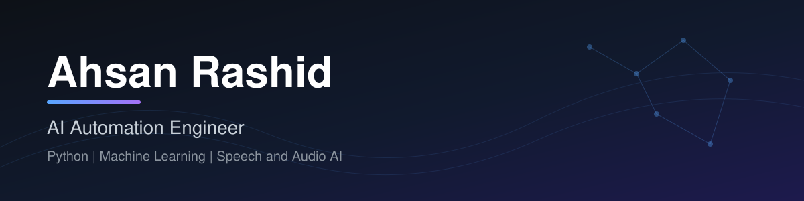

<p align="center">

</p>

# Hi, I'm Ahsan Rashid

**AI Automation Engineer at Zeploy Tech | Software Engineering Student at UMT | Lahore, Pakistan**

I build AI that does real work. I turn manual processes into automated systems using Python and machine learning, and I am working on speech and audio models that can spot deepfake voice notes in Urdu.

- At **Zeploy Tech**, I build AI automation that replaces repetitive manual work.
- I lead a team of three on **VOICE GUARD**, my final year project, a web based deepfake voice note detector for Urdu.
- I am a BS Software Engineering student at **University of Management and Technology (UMT), Lahore** (2023 to 2027).

[](https://www.linkedin.com/in/ahsan-rashid-niazi/)
[](https://github.com/ahsanakn1041)

### Open To


## Education

**B.S. Software Engineering**
University of Management and Technology (UMT), Lahore
`2023 - 2027`

---

## Tech Stack

### Languages

<div align="center">

[](https://skillicons.dev)

</div>

### AI / ML

<div align="center">


</div>

### Tools

<div align="center">

[](https://skillicons.dev)


</div>

---

## What I Work On

| Area | Where I have applied it |
|:---|:---|
| **Speech and audio AI** | VOICE GUARD: detecting deepfake voice notes in Urdu |
| **AI automation** | Zeploy Tech: turning manual workflows into automated systems |
| **Developer tooling** | Pulsecheck: a CI ready scanner for secrets, TODO markers and long lines |
| **Engineering process** | Requirements first, sprint sized work, documented and tested code |

---

## Experience

### AI Automation Engineer | Zeploy Tech
`Apr 2026 - Present` | Lahore

- Build AI automation systems that replace repetitive manual work.
- Work in Python with machine learning to deliver working automations.

`Python` `Machine Learning` `Automation`

---

## Featured Projects

<details>
<summary><strong>VOICE GUARD | Urdu Deepfake Voice Note Detector</strong></summary>

<br/>

A web based tool that detects deepfake and cloned voice notes in Urdu.

| | |
|:---|:---|
| **Stack** | Python, audio processing, deep learning |
| **How we work** | Team of three, 45 features split across the team, Scrum sprints, free tools only |
| **Why it matters** | People act on voice notes without a second thought, and a cloned voice can exploit that trust |
| **Context** | Final year project, UMT Lahore. Proposal approved. |
| **Status** | In development |

</details>

<details>
<summary><strong>Pulsecheck | Repository Scanner CLI</strong></summary>

<br/>

A Python command line tool that scans repositories for potential secrets, TODO markers and overly long lines.

| | |
|:---|:---|
| **Stack** | Python, pytest |
| **Engineering** | Built for CI with clear exit codes and pytest coverage |
| **Links** | [Repository](https://github.com/ahsanakn1041/Pulsecheck) |

</details>

---

## Contribution Activity

<div align="center">


</div>

---

## Currently

```yaml
building:
- VOICE GUARD, an Urdu deepfake voice note detector
- AI automation systems at Zeploy Tech
learning:
- Speech and audio machine learning
- Model evaluation and production ML
open_to:
- AI, machine learning and AI automation roles
- Founders with a manual process they want automated
```

## Connect With Me

<div align="center">

[](https://www.linkedin.com/in/ahsan-rashid-niazi/)
[](https://github.com/ahsanakn1041)

</div>

---
